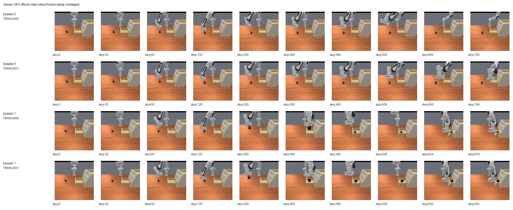

# TRO1 automated, sanitized experiment evidence

- Task: `toys_in_drawer`
- Status: `READ_ONLY_DIAGNOSIS_NOT_NEW_ROLLOUT` (may be DEV; not paper-ready)
- Source in project: `outputs/roboreel_video_dependency_diagnosis/drawer_hf_v1`
- Reported PhysX rollouts: `None`
- Paired episodes: `None`
- Any pair differs in success: `None`
- These are *copied numeric findings*, not new runs; raw video, model and gated datasets are excluded.

## Per-trial results

| Episode | TRAIN demo ID | Steps | Success | Runtime error type |
|---:|---:|---:|---|---|
| — | — | — | — | — |

## Matched pair action sensitivity

| Episode | Success outcomes | Full mean 8D action L2 |
|---:|---|---:|
| — | — | — |

## Artifact verification

- `evidence.json` contains source SHA256 hashes and the detailed sanitized metrics.
- All uploads are snapshots: existing changed evidence files will never be overwritten.
- This branch is dedicated to measurements; the repository `main` branch is unaffected.

## Read-only action-difference diagnosis

- Episode 0: first action L2=0.000774449, first20 mean=0.001442696, full mean=1.340732694
- Episode 1: first action L2=0.001250848, first20 mean=0.001331879, full mean=0.270444125

## ROBOT policy rollout preview (not original human demonstrations)

