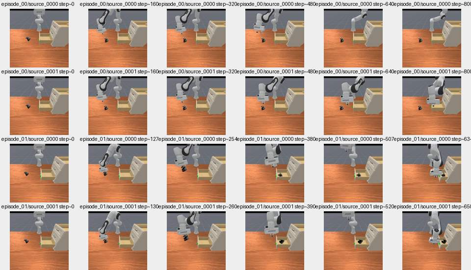

# TRO1 automated, sanitized experiment evidence

- Task: `toys_in_drawer`
- Status: `DEV_COMPLETE_NOT_FORMAL` (may be DEV; not paper-ready)
- Source in project: `outputs/roboreel_video_dependency_dev/drawer_hf_v1`
- Reported PhysX rollouts: `4`
- Paired episodes: `2`
- Any pair differs in success: `False`
- These are *copied numeric findings*, not new runs; raw video, model and gated datasets are excluded.

## Per-trial results

| Episode | TRAIN demo ID | Steps | Success | Runtime error type |
|---:|---:|---:|---|---|
| 0 | 0 | 800 | False | NONE |
| 0 | 1 | 800 | False | NONE |
| 1 | 1 | 650 | True | NONE |
| 1 | 0 | 634 | True | NONE |

## Matched pair action sensitivity

| Episode | Success outcomes | Full mean 8D action L2 |
|---:|---|---:|
| 0 | [False, False] | 1.340732694 |
| 1 | [True, True] | 0.270444125 |

## Artifact verification

- `evidence.json` contains source SHA256 hashes and the detailed sanitized metrics.
- All uploads are snapshots: existing changed evidence files will never be overwritten.
- This branch is dedicated to measurements; the repository `main` branch is unaffected.

## ROBOT policy rollout preview (not original human demonstrations)

